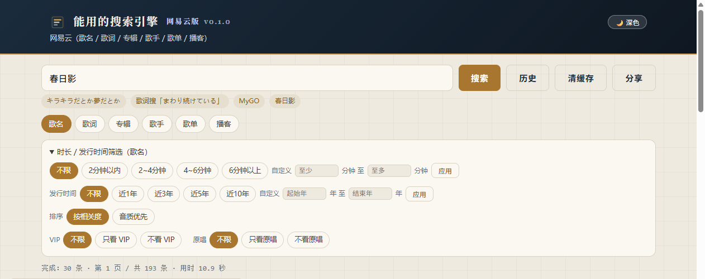

# 能用的搜索引擎（usable-search-engine-NECM）网易云版

> 本仓库是 **网易云版**：只保留网易云搜索功能（歌名 / 歌词 / 专辑 / 歌手 / 歌单 / 播客）。


中文 · [English](README.en.md)

<p align="center">
  <a href="https://github.com/kipp546IO/usable-search-engine-NECM/releases/download/v0.1.0/usable-search-netease-v0.1.0.zip"></a>
</p>

<p align="center"><sub>下载后解压 → 双击 <code>install.cmd</code> → 浏览器自动打开。不需要装别的东西。</sub></p>

<div align="center">
<table>
<tr><td align="center" width="20%"><a href="docs/share/wechat-qr.png"></a><br><sub>微信</sub></td><td align="center" width="20%"><a href="https://connect.qq.com/widget/shareqq/index.html?url=https%3A%2F%2Fgithub.com%2Fkipp546IO%2Fusable-search-engine-NECM&amp;title=%E8%83%BD%E7%94%A8%E7%9A%84%E6%90%9C%E7%B4%A2%E5%BC%95%E6%93%8E%20%C2%B7%20%E7%BD%91%E6%98%93%E4%BA%91%E7%89%88"></a><br><sub>QQ</sub></td><td align="center" width="20%"><a href="https://sns.qzone.qq.com/cgi-bin/qzshare/cgi_qzshare_onekey?url=https%3A%2F%2Fgithub.com%2Fkipp546IO%2Fusable-search-engine-NECM&amp;title=%E8%83%BD%E7%94%A8%E7%9A%84%E6%90%9C%E7%B4%A2%E5%BC%95%E6%93%8E%20%C2%B7%20%E7%BD%91%E6%98%93%E4%BA%91%E7%89%88&amp;summary=%E8%83%BD%E7%94%A8%E7%9A%84%E6%90%9C%E7%B4%A2%E5%BC%95%E6%93%8E%20%C2%B7%20%E7%BD%91%E6%98%93%E4%BA%91%E7%89%88"></a><br><sub>QQ空间</sub></td><td align="center" width="20%"><a href="https://service.weibo.com/share/share.php?url=https%3A%2F%2Fgithub.com%2Fkipp546IO%2Fusable-search-engine-NECM&amp;title=%E8%83%BD%E7%94%A8%E7%9A%84%E6%90%9C%E7%B4%A2%E5%BC%95%E6%93%8E%20%C2%B7%20%E7%BD%91%E6%98%93%E4%BA%91%E7%89%88"></a><br><sub>微博</sub></td><td align="center" width="20%"><a href="https://tieba.baidu.com/f/commit/share/openShareApi?url=https%3A%2F%2Fgithub.com%2Fkipp546IO%2Fusable-search-engine-NECM&amp;title=%E8%83%BD%E7%94%A8%E7%9A%84%E6%90%9C%E7%B4%A2%E5%BC%95%E6%93%8E%20%C2%B7%20%E7%BD%91%E6%98%93%E4%BA%91%E7%89%88"></a><br><sub>贴吧</sub></td></tr>
<tr><td align="center" width="20%"><a href="docs/SHARE.md"></a><br><sub>小红书</sub></td><td align="center" width="20%"><a href="docs/SHARE.md"></a><br><sub>LOFTER</sub></td><td align="center" width="20%"><a href="docs/SHARE.md"></a><br><sub>Instagram</sub></td><td align="center" width="20%"><a href="https://twitter.com/intent/tweet?url=https%3A%2F%2Fgithub.com%2Fkipp546IO%2Fusable-search-engine-NECM&amp;text=%E8%83%BD%E7%94%A8%E7%9A%84%E6%90%9C%E7%B4%A2%E5%BC%95%E6%93%8E%20%C2%B7%20%E7%BD%91%E6%98%93%E4%BA%91%E7%89%88"></a><br><sub>X</sub></td><td align="center" width="20%"><a href="https://t.me/share/url?url=https%3A%2F%2Fgithub.com%2Fkipp546IO%2Fusable-search-engine-NECM&amp;text=%E8%83%BD%E7%94%A8%E7%9A%84%E6%90%9C%E7%B4%A2%E5%BC%95%E6%93%8E%20%C2%B7%20%E7%BD%91%E6%98%93%E4%BA%91%E7%89%88"></a><br><sub>Telegram</sub></td></tr>
</table>
</div>

<p align="center"><sub>微信扫码打开 · 小红书 / LOFTER / Instagram 点开是现成文案，复制粘贴即可</sub></p>

<h2 align="center">对抗算法与推荐</h2>

キラキラだとか夢だとか 希望だとかドキドキだとかで⭐

## 🔍 这是什么

一个**自建索引**的搜索工具，用来替代主流平台越来越搜不到东西的搜索功能。

运作方式：搜集数据 → 建立本地索引 → 按你的规则排序展示

## 💥 为什么做这个

Poppin'Party「キラキラだとか夢だとか ～Sing Girls～」在网易云音乐⬇️

- 库里至少 **3 个原唱版本**（单曲版 /《Poppin'on!》版 / TV Size），全部可播放、歌手页可见；
- 但单曲搜索把原唱排在**两百多条结果的最后三位（第 227~229 位）**，第一屏全是伴奏版、网友翻唱和无关内容，要翻到最后才能看到！！！
- 无论是否把全名打全，搜索结果都不会返回原唱
- 从自己的歌单里却能正常找到，这说明网易云的搜索引擎不能正常使用

同一套搜索对不同歌曲行为还不一致：同专辑的「ときめきエクスペリエンス！」原唱稳居第 1，而「キラキラ」「ティアドロップス」「前へススメ！」等曲子的原唱要么沉底、要么干脆消失，这简直是异变☯️！

## 🧩 与现有项目的差异

其他搜索大多是官方接口的搬运工，而本项目：

- **索引层**：自建本地索引。你歌单里的、专辑里的、歌手页里的——全部入库，永远搜得到
- **排序层**：自己的规则。精确命中优先、同一首歌的全部版本并列、不折叠、不插推广

详见 [docs/RESEARCH.md](docs/RESEARCH.md)（同类项目调研）与 [docs/DESIGN.md](docs/DESIGN.md)（设计草案）

## 🛠 技术栈

纯 Python 3.10+（**只用标准库**：urllib / sqlite3 / http.server / json / threading）＋ SQLite（FTS5 trigram 与 LIKE 双路径）＋ 单页 HTML（无框架、无构建）

## ⚡ 三分钟上手（零基础也看得懂）

### 第 1 步 · 装 Python（只装一次）

1. 打开 <https://www.python.org/downloads/>，点黄色大按钮下载
2. 双击安装包，**第一屏底部一定要勾上 `Add python.exe to PATH`**，再点 Install Now
3. 装完把弹出的黑窗口都关掉

> 怎么确认成功：按 `Win + R`，输入 `cmd` 回车，在黑窗口里打 `python -V`，能看到 `3.10` 以上就行

### 第 2 步 · 拿到项目

- **省事版**：本页右上角点 `Code` → `Download ZIP`，解压到任意目录（别放 `C:\Program Files`，那里没写权限）
- **Git 版**：`git clone https://github.com/kipp546IO/usable-search-engine-NECM.git`

### 第 3 步 · 双击启动（就一下）

- **Windows**：双击 `install.cmd`。会弹出一个黑窗口，几秒后浏览器自动打开页面
- **macOS / Linux**：在项目目录里执行 `bash install.sh`

**那个黑窗口要留着** —— 它就是服务本身，关掉窗口 = 关掉服务。想停就关它。

### 第 4 步 · 开始搜

地址固定是 <http://127.0.0.1:18788/>，建议加进收藏夹。输入歌名回车即可

- 第一次搜会现场抓数据，慢几秒是正常的；同一查询 10 分钟内走缓存
- 筛选面板可以按时长、发行时间、音质、VIP、原唱过滤

### 下次再开

再双击一次 `install.cmd` 就行，没有别的步骤

## 📦 下载即用（快速开始）

需要 Python 3.10 或更高版本。**不需要装任何第三方库**

方式一（推荐）：装成包再用，命令最干净

```
git clone https://github.com/kipp546IO/usable-search-engine-NECM.git
cd usable-search-engine
python -m venv .venv
.venv\Scripts\activate          # Windows；macOS/Linux 用 source .venv/bin/activate
pip install -e .
python -m usable_search serve
```

方式二（完全免安装、不碰 pip）：直接把 `src` 加进模块路径

- Windows PowerShell：`$env:PYTHONPATH="src"; python -m usable_search serve`
- Windows cmd：`set PYTHONPATH=src && python -m usable_search serve`
- macOS/Linux：`PYTHONPATH=src python -m usable_search serve`
- 或者直接双击 `start-search-service.cmd`（仅 Windows，自带守护，崩了 5 秒自动重启）

起来以后浏览器打开 <http://127.0.0.1:18788/>

- 数据目录 `data/` 首次运行自动创建（曲库、歌词、档案、治理账本、接口探针），不进 git
- 服务只监听 `127.0.0.1`，不对外网开放，不会暴露到局域网或公网
- 首次搜索要现场抓取，慢几秒是正常的；同一查询 10 分钟内走缓存
- 换端口：`python -m usable_search serve --port 你的端口`

### 使用前请知悉

- 抓取走的是网易云的**公开接口（非官方）**，风控按 IP 判断：**请低频使用**
- 本项目不提供、不转发、不缓存任何音视频内容；只保存元数据与歌词文本，仅供个人研究与检索使用
- 许可：MIT，见 `LICENSE`

## ✨ 功能一览（v0.1.0）



**搜索**

- 网易云六种精确搜索：歌名 / 歌词（命中行高亮并置顶）/ 专辑 / 歌手 / 歌单 / 播客
- 自己的排序口径：原唱去混淆、歌单收藏置顶、标签命中可见化
- 分页 30 / 50 / 100 / 300，页间不重复

**筛选**

- 时长：2 分钟以内 / 2~4 / 4~6 / 6 分钟以上 / 自定义
- 发行时间：近 1 / 3 / 5 / 10 年，或自定义年份区间
- 音质排序：超清母带 > 高清臻音 > 无损 > 极高 > 较高 > 标准，同档保持原相关度顺序
- VIP / 原唱：各自支持「不限 / 只看 / 不看」三态

**读数**

- 每张卡片标注：最高可用音质、是否 VIP、以及原唱 / 翻唱 / 改编 / 其他版本 / 未标注
- 整卡可点（新标签打开网易云页面）；点歌手或专辑直接跳到对应的歌手页/专辑页搜索结果
- 版本判定以接口字段为主（originCoverType），接口没标的会显式写「未标注」，不做无依据的断言

**体验**

- 深色 / 浅色主题，首次跟随系统，之后记住选择
- 结果内二次筛选：不重新联网，只在已拿到的结果里过滤
- 搜索历史存在本机浏览器（可单条删除，不上传）
- 清缓存面板，点之前先说清会清掉什么

**工程**

- 纯 Python 标准库（urllib / sqlite3 / http.server），零第三方依赖
- 本地 SQLite 索引，搜索词不写进探针库
- 接口可用性探针（成功率、p50、p95）、档案与下架复查、播放备份站（默认关闭）

## ❓ 常见问题

**会不会把我账号封了？**
不会。全程匿名、不带登录态、不发账号操作请求，只读公开搜索接口。真正要注意的是**别高频刷**——风控跟 IP 走，刷太猛会被临时挡

**为什么有的歌搜不到，或者很慢？**
搜索是现场抓取 + 本地索引，第一次查要联网。个别查询平台不给、被风控挡，都会表现为慢或空。先换关键词，或者过一会儿再试

**数据存在哪？删了会怎样？**
在项目目录的 `data/` 里，四个 SQLite 文件。删掉整个 `data/` 等于清空曲库和记录，下次搜索会重新积累。不会影响你的网易云账号

**我的搜索记录会被上传吗？**
不会。历史只存在你浏览器的 localStorage；服务端只记接口成功率和耗时，不落搜索词

**端口 18788 被别的软件占了怎么办？**
启动时加 `--port 其他端口`，或者改 `install.cmd` 顶部的 `PORT`

**能装到手机上吗？**
目前是桌面网页形态。Android 原生版本在计划里，还没做

**为什么有些歌没标"原唱"？**
平台接口只有部分歌曲带版本标记，没带的会显示「未标注」；同批里有明确原唱时会推测并标注（悬停有说明）。宁可标"不知道"，也不瞎猜

**怎么卸载？**
删掉整个项目文件夹即可。它是绿色的，不写注册表、不开机自启（除非你自己把 `tools/autostart` 里那个 vbs 放进启动目录）

## 🧪 本地试用（M1 原型 v0.2）

```bash
# 多入口聚合搜索（首次会联网采集并入库）
PYTHONPATH=src python -m usable_search search "キラキラだとか夢だとか"

# 歌单全量入库（公开歌单 id）
PYTHONPATH=src python -m usable_search ingest-playlist 14174016119

# 统一搜索框（本机网页 http://127.0.0.1:18788/）
PYTHONPATH=src python -m usable_search serve

# 召回回归测试（M1 验收口径：全绿才算过）
PYTHONPATH=src python tests/test_recall.py
```

索引文件落在 `data/index.sqlite3`（已 gitignore）

## 🚧 边界

- 数据仅供个人使用；抓取遵守平台限速、礼貌访问；
- 开源仓库不含任何抓取回的内容数据；
- 不提供任何受版权保护内容的下载与再分发。
